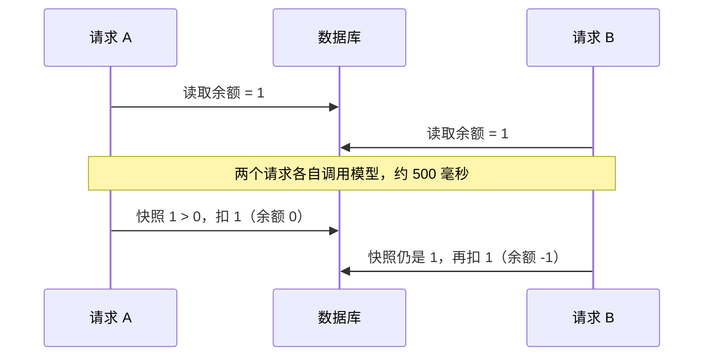
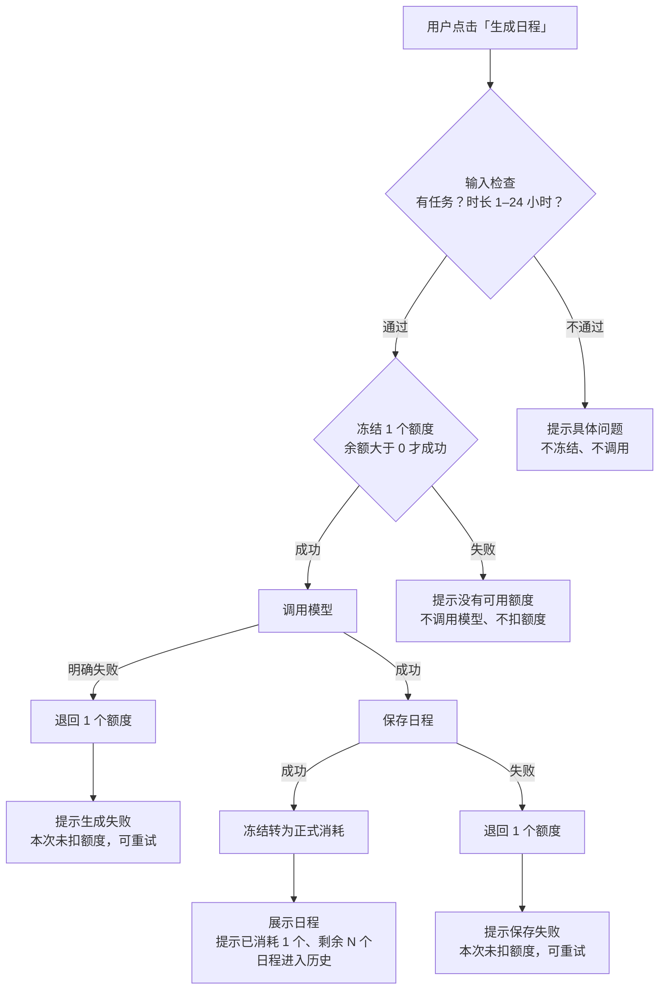
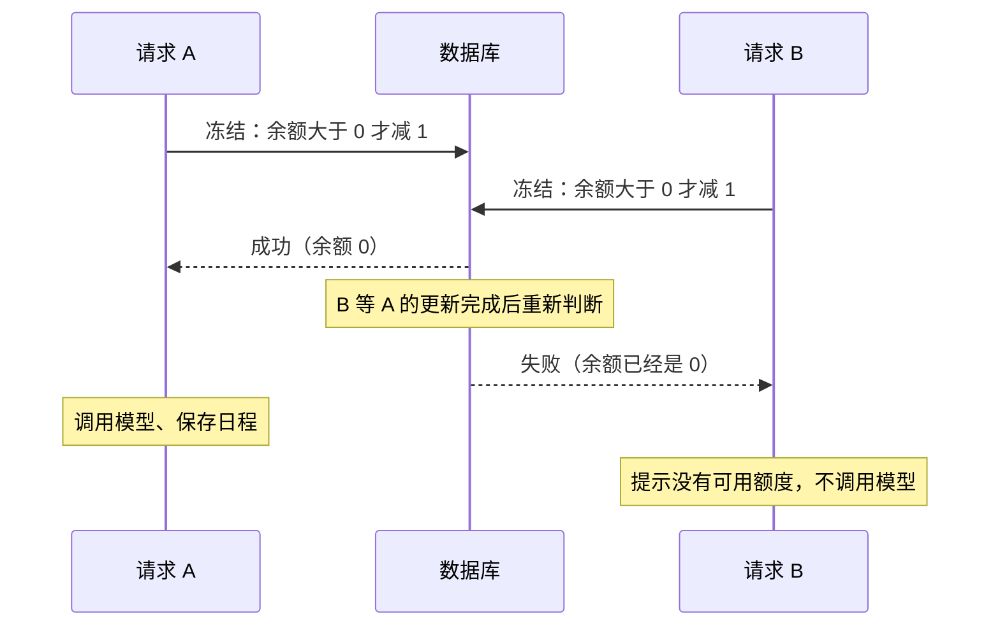

# 额度处理改进方案

产品方向交付。文档索引：方案（本文）｜[原型](02-prototype/README.md)｜[任务拆解](03-tasks.md)｜[验收案例](04-acceptance.md)

## 结论

**问题判断**：现在生成日程是先调模型、后查额度，而且查的是请求刚进来时读到的余额。由此产生三个问题：额度为 0 也会调用模型；同一账号的并发请求能把余额扣成负数；模型失败时，用户只看到英文技术报错，不知道扣没扣额度、下一步做什么。此外，生成的日程已经存进数据库，页面却从不展示，刷新就看不到了。

**方案**：额度改为"先冻结、后结算"。调用模型前先冻结 1 个额度：余额大于 0 才能冻结成功，判断和扣减由数据库一步完成。日程生成并保存后，冻结的额度正式消耗；中途任何一步失败，就把冻结的额度退回。每种结果都告诉用户四件事：发生了什么、扣没扣额度、还剩多少、接下来能做什么。

**完成状态**：需求方案、流程、原型、任务拆解、验收案例已完成。按产品方向要求，没有改代码。现状问题来自代码阅读；在当前代码上的实测情况见[基线对照](04-acceptance.md#基线对照)。

## 现状问题

| # | 问题 | 原因 | 违反规则 |
|---|---|---|---|
| P1 | 额度为 0 仍调用模型，结果丢弃后才返回额度不足 | `generatePlan` 先[调用模型](../../src/demo-ai-app/operations.ts#L49)，后[检查额度](../../src/demo-ai-app/operations.ts#L67) | R2 |
| P2 | 并发请求可以透支，余额变成负数 | 检查用的是请求进入时的余额快照 `context.user.credits`；扣减不带"余额大于 0"的条件 | R4 |
| P3 | 模型失败时提示是英文技术报错 | 模拟接口抛出普通错误，没有转成面向用户的错误，前端只能显示通用的 500 信息 | R5 |
| P4 | 额度不足的提示没有下一步 | [文案](../../src/demo-ai-app/DemoAppPage.tsx#L101)只写了"请检查账号状态" | R5 |
| P5 | 已生成的日程刷新就丢 | 结果已保存，页面只把它放在内存里，没有读取已保存的日程（查询 `getPlanResults` 写好了没人调用） | R5 |

P2 的过程（余额为 1，两个请求同时到达）：

## 目标规则

| 规则 | 本方案的定义 | 怎么观察 |
|---|---|---|
| R1 成功一次扣 1 | "成功"指用户拿到日程：模型返回成功，且日程已经保存 | 余额减 1，历史日程加 1 |
| R2 额度不足不调用 | 冻结失败就结束，不发起调用 | 没有 `mock-ai.started` 日志 |
| R3 模型失败不扣 | 冻结的额度退回 | 请求结束后余额与请求前相同 |
| R4 并发不透支 | 只有冻结成功的请求能调用模型 | 余额始终不小于 0 |
| R5 看得懂结果、知道下一步 | 每种结果都有固定文案 | 对照[界面状态与文案](#界面状态与文案)逐条检查 |

## 范围与假设

本次范围：生成日程时的额度判断，冻结、消耗、退回，结果提示，余额展示，历史日程，生成前的输入检查。

不在范围（题目给定）：支付与充值、订阅、跨账号防刷、按 Token 计价、服务崩溃后的自动补偿、跨请求复用结果。

假设：

- 单服务、单数据库（题目给定）。
- 一条 `mock-ai.started` 日志代表一次计费调用（题目给定）。
- 模拟调用约 0.5 秒。真实模型可能要几十秒，方案不依赖调用时长。
- "联系管理员"的具体渠道尚未确定，见[待确认](#待确认)。

## 关键决策

| # | 决策 | 理由 | 代价或局限 |
|---|---|---|---|
| D1 | 先冻结、后结算：调用前冻结 1 个额度，成功后正式消耗，失败退回 | 同时满足 R2 和 R4，又不用在模型调用期间一直锁着数据 | 冻结后服务崩溃，这 1 个额度会丢失（题目不要求补偿，列入[待办](#待办)） |
| D2 | 模型成功但保存失败，退回额度 | 用户没拿到结果就不付费 | 这次模型调用的成本由平台承担 |
| D3 | 额度不够时，多出来的并发请求立即拒绝，不排队 | 用户马上知道结果；不占用数据库连接 | 被拒之后，额度可能因为别的请求失败又退回来 |
| D4 | 被拒提示一次说清两种可能：额度已用完，或有一次生成正在进行；不额外记录进行中的数量 | 实现最简单 | 没法告诉用户具体是哪一种（列入[待办](#待办)） |
| D5 | 额度用完后，给用户三个下一步：查看历史日程；说明当前版本暂不支持充值；联系管理员申请额度 | 支付不在范围内；历史日程让用户仍能用上已有结果 | 管理员渠道待定 |
| D6 | 失败提示面向用户，写明"本次未扣除额度，可以重试"，不显示技术报错 | R5 | 无 |
| D7 | 输入检查放在冻结之前：必须有任务，时长 1–24 小时 | 不合法的请求不冻结、不调用 | 无 |
| D8 | 余额为 0 时，生成按钮置灰并说明原因 | 点击之前就让用户知道 | 多个标签页时，页面上的余额可能过期，最终以服务端判断为准 |

参考：Wasp 官方 Open SaaS 模板在 [PR #738](https://github.com/wasp-lang/open-saas/pull/738) 中用了同样的"预扣 + 失败退回"思路，本项目的基线代码与该 PR 修复前的版本基本一致。本方案在此基础上补齐失败提示、历史日程、检查顺序和验收案例。

## 哪一步防止透支

关键在冻结这一步。它是一次"余额大于 0 才减 1"的数据库更新，判断和扣减在同一条更新里完成。两个请求同时争最后 1 个额度时，数据库让后到的请求等前一个完成，再重新判断余额。这时余额已经是 0，后到的请求冻结失败，也就不会调用模型。

"先读余额、再扣"的写法挡不住并发：两个请求可能都读到 1，然后各扣 1。即使把读和扣放进同一个事务，在 PostgreSQL 的默认设置下，没有显式加锁的话也一样会出问题。

对应验收案例：AC-07、AC-08、AC-09。

## 主流程

改进后的并发过程（余额为 1）：

## 界面状态与文案

| 状态 | 出现时机 | 界面表现 | 文案 | 用户下一步 |
|---|---|---|---|---|
| S1 可生成 | 余额至少 1，且有任务 | 按钮可点，按钮下方一行说明 | 本次将消耗 1 个额度，生成失败不扣除。当前剩余 N 个。 | 点击生成 |
| S2 生成中 | 点击后到结果返回前 | 按钮显示加载，不能再点 | 生成中… | 等待 |
| S3 成功 | 日程返回 | 展示日程，顶部余额刷新，弹出提示 | 日程已生成，消耗 1 个额度，剩余 N 个。 | 查看日程，也可以之后在历史日程里找回 |
| S4 额度用完 | 打开页面时余额为 0 | 按钮置灰，按钮下方显示说明 | 额度已用完。当前版本暂不支持充值，如需更多额度，请联系管理员。已生成的日程仍可在下方查看。 | 查看历史日程；联系管理员 |
| S5 没有可用额度（被拒） | 点击后冻结失败 | 弹出提示 | 暂时没有可用额度，本次未调用模型，也未扣除额度。可能有一次生成正在进行，请稍后刷新查看余额；如果额度已用完，可以联系管理员申请。 | 稍后刷新；查看历史日程；联系管理员 |
| S6 生成失败 | 模型明确返回失败 | 弹出错误提示 | 生成失败，本次未扣除额度，请稍后重试。 | 重试 |
| S7 保存失败 | 日程保存失败 | 弹出错误提示 | 日程未能保存，本次未扣除额度，请重试。 | 重试 |
| S8 输入不合法 | 没有任务，或时长不在 1–24 小时 | 不发请求，在对应位置提示 | 请先添加待办事项 ／ 可用时长需在 1–24 小时之间 | 修改输入 |
| S9 历史日程 | 有已生成的日程时一直显示 | 生成按钮下方的列表，按时间倒序 | 历史日程（共 N 份） | 展开查看 |

界面效果见[原型](02-prototype/README.md)。

## 边界情况

| 情况 | 处理 |
|---|---|
| 多个标签页同时操作 | 页面上的余额可能过期，以服务端冻结结果为准；被拒时显示 S5 |
| 快速连点 | 生成中按钮不可点；即使重复请求到达服务端，也按 D3 处理 |
| 生成中刷新或关闭页面 | 服务端照常完成：成功就扣额度并保存，刷新后能在历史日程里看到 |
| 生成中断网 | 同上；用户先到历史日程确认结果，避免重复生成 |
| 旧逻辑留下的负余额 | 上线前查一遍，负余额按 0 处理并人工核对 |
| 已勾选完成的任务 | 维持现状，仍参与生成，见[待确认](#待确认) |

## 待确认

1. "联系管理员"的具体渠道：邮箱、表单还是客服入口。
2. 已完成的任务是否还应参与日程生成。
3. 历史日程保留多少份，是否允许删除。

## 待办

本次不做，留给后续：

- 冻结后服务崩溃导致的额度丢失：需要记录每次冻结，超时未结算的自动退回。
- 区分"额度已用完"和"有生成正在进行"（D4 的局限）：需要记录进行中的冻结数量。
- 模型调用超时：真实模型可能长时间不返回，冻结会一直挂着；需要设置超时，超时按失败处理。
