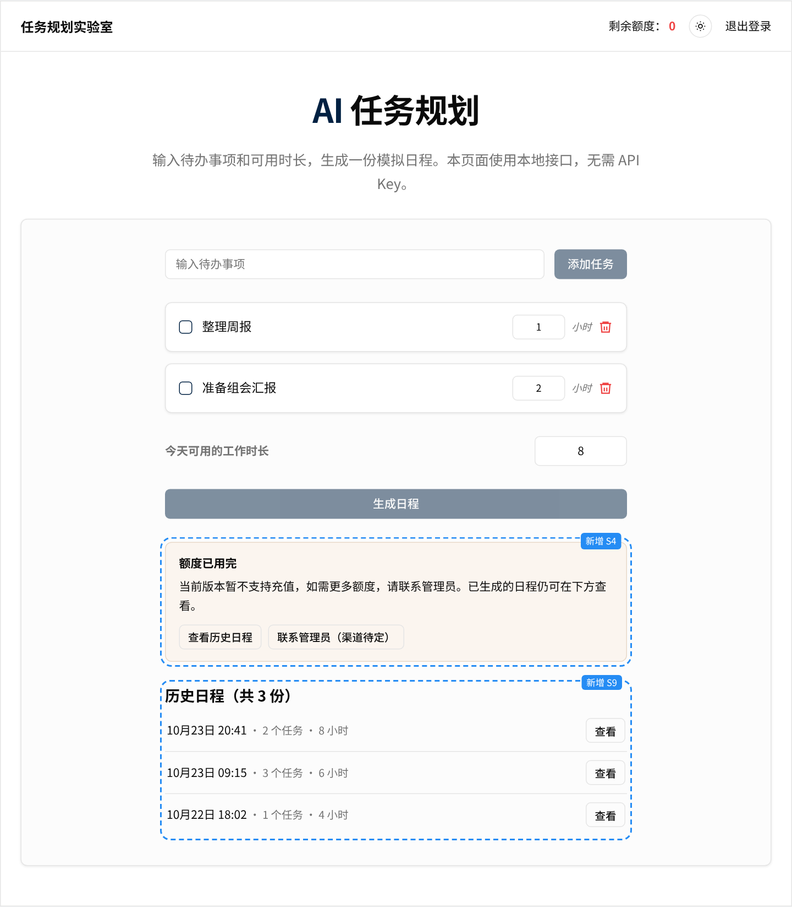
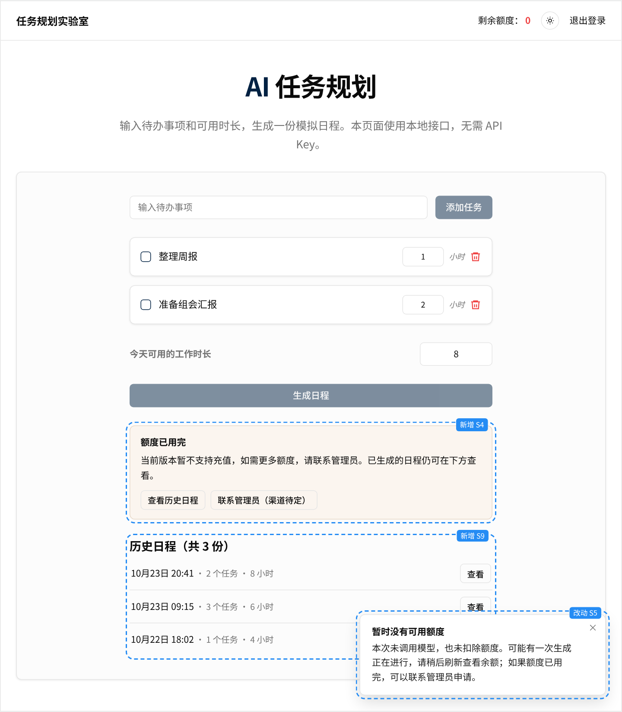
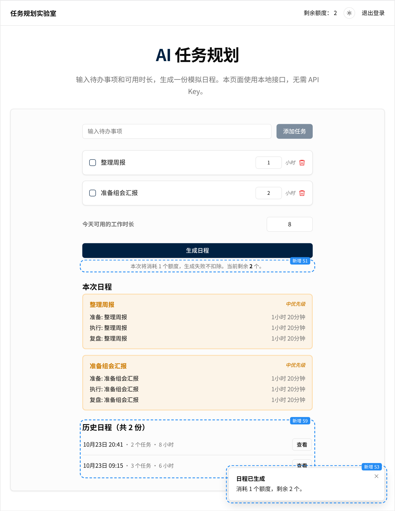

# 界面原型

静态原型，只用来示意各状态的界面和文案，文案定义以[方案](../01-solution.md#界面状态与文案)为准。弹出提示把文案的第一句作为标题，其余作为正文。

- 交互版：用浏览器打开 [index.html](index.html)，顶部按钮切换 S1–S9。
- 截图中的蓝色虚线框是本次新增或改动的部分，标签注明对应的状态。

| 状态 | 截图 | 要点 |
|---|---|---|
| S1 可生成 | [S1.png](screenshots/S1.png) | 按钮下方说明本次消耗和剩余额度 |
| S2 生成中 | [S2.png](screenshots/S2.png) | 按钮加载中、不可点，防止重复提交 |
| S3 成功 | [S3.png](screenshots/S3.png) | 展示日程；提示消耗与剩余；日程进入历史 |
| S4 额度用完 | [S4.png](screenshots/S4.png) | 按钮置灰；给出三个下一步 |
| S5 没有可用额度（被拒） | [S5.png](screenshots/S5.png) | 说明未调用、未扣额度，并覆盖"有生成正在进行"的可能 |
| S6 生成失败 | [S6.png](screenshots/S6.png) | 说明未扣额度，可以重试 |
| S7 保存失败 | [S7.png](screenshots/S7.png) | 与 S6 相同的处理，文案区分原因 |
| S8 输入不合法 | [S8.png](screenshots/S8.png) | 时长超出 1–24 小时，就地提示，不发请求 |
| S9 历史日程 | [S9.png](screenshots/S9.png) | 刷新后仍能找回已生成的日程 |

## 关键状态

S4 额度用完：

S5 没有可用额度（被拒）：

S3 成功：

