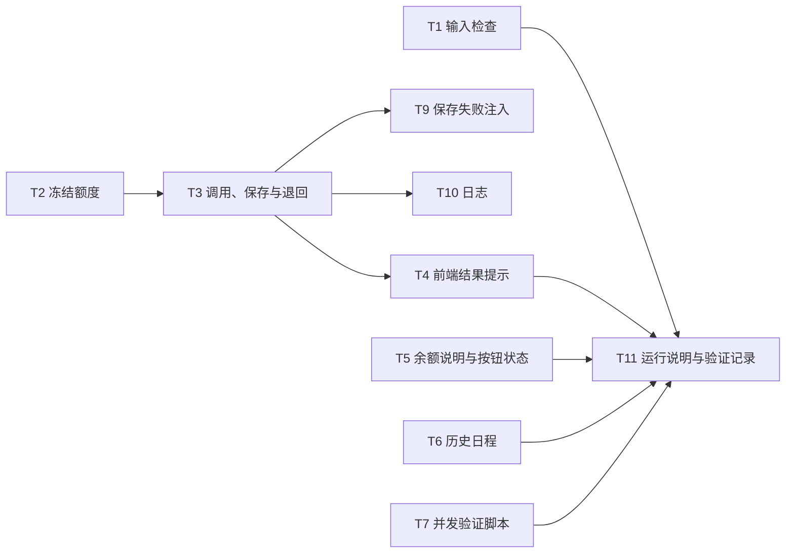

# 开发任务拆解

依据[方案](01-solution.md)拆解，完成标准是[验收案例](04-acceptance.md)。

## 实现约束

开发者和 AI 都按这几条执行：

- 完成标准是 04 的验收案例；界面文案以 01 的[界面状态与文案](01-solution.md#界面状态与文案)为准。
- 不改 `src/demo-ai-app/mockAi.ts`。它代表外部模型，`mock-ai.started` 的条数是验收依据。
- 额度判断不能使用 `context.user.credits`，那是请求进入时的快照。"判断 + 扣减"必须在数据库里一步完成。
- 调用模型期间不持有数据库事务或锁。
- 可参考 Open SaaS [PR #738](https://github.com/wasp-lang/open-saas/pull/738) 的冻结与退回写法；本项目另需补齐错误提示、输入检查顺序和历史日程。

## 任务

| ID | 任务 | 要点 | 依赖 | 估时 | 优先级 | 验收 |
|---|---|---|---|---|---|---|
| T1 | 输入检查前置 | 冻结额度之前检查：至少 1 条任务，时长在 1–24 小时之间；不通过直接返回 S8，不冻结、不调用 | 无 | 0.5h | P0 | AC-11、AC-12 |
| T2 | 冻结额度 | 一条"余额大于 0 才减 1"的条件更新，按受影响的行数判断成败；失败返回 S5，并带可识别的错误类型（如 `NO_CREDITS`） | 无 | 1h | P0 | AC-03、AC-07、AC-08 |
| T3 | 调用、保存与退回 | 冻结成功后调用模型、保存日程；任一步失败，退回 1 个额度，返回 S6 或 S7，并带错误类型（如 `MODEL_FAILED`、`SAVE_FAILED`）；技术报错只写日志，不返回前端 | T2 | 1.5h | P0 | AC-04、AC-05、AC-06、AC-09 |
| T4 | 前端结果提示 | 按错误类型显示 S5–S7；成功时显示 S3，带消耗和剩余 | T2、T3 | 1h | P0 | AC-01、AC-03、AC-04 |
| T5 | 余额说明与按钮状态 | 按钮下方显示 S1；余额为 0 时按钮置灰并显示 S4；生成中禁用（S2）；输入不合法时提示 S8 | 无 | 1h | P0 | AC-02、AC-10、AC-11、AC-12 |
| T6 | 历史日程 | 使用已有查询 `getPlanResults`，补上按时间倒序；页面展示列表（S9），刷新后仍可见 | 无 | 1.5h | P0 | AC-02、AC-13 |
| T7 | 并发验证脚本 | 按 04 的[并发验证要求](04-acceptance.md#并发验证要求)实现；可重复执行，输出逐项比对结果 | 无 | 2h | P0 | AC-07、AC-08、AC-09 |
| T8 | 数据库兜底约束 | 迁移中加入"余额不小于 0"的约束；上线前检查并处理已有的负余额 | 无 | 0.5h | P1 | AC-07、AC-08 |
| T9 | 保存失败注入 | 只在测试环境可开启，让保存日程这一步失败 | T3 | 1h | P1 | AC-06 |
| T10 | 冻结与退回日志 | 冻结、退回各记一条结构化日志，带用户和请求标识，方便对账 | T2、T3 | 0.5h | P2 | 辅助 AC-07 至 AC-09 |
| T11 | 运行说明与验证记录 | README 补充并发脚本的运行方式；在 04 中逐条填写实测结果 | T1–T7 | 1h | P0 | 全部 |

估时合计：P0 共 9.5 小时，P1 共 1.5 小时，P2 共 0.5 小时。按熟悉本项目的开发者估算。

## 依赖关系

T8 不依赖其他任务，随时可做。

## 建议顺序

| 阶段 | 任务 | 完成标志 |
|---|---|---|
| M0 先写验证 | T7 | 在当前代码上跑出 AC-07 至 AC-09 的失败结果，与 04 的基线对照一致，确认问题可以复现 |
| M1 后端规则 | T1、T2、T3 | T7 跑 AC-07 至 AC-09 连续 3 次通过；AC-03、AC-04、AC-11、AC-12 在接口层通过 |
| M2 界面 | T4、T5、T6 | AC-01、AC-02、AC-10、AC-13 通过 |
| M3 收尾 | T11 | 04 中每条案例都有实测结果 |
| M4 加固 | T8、T9、T10 | AC-06 通过；兜底约束生效 |

先写 T7 有两个好处：改代码前就能看到问题，改完后同一个脚本就是回归测试。
